<p align="center">
  <picture>
    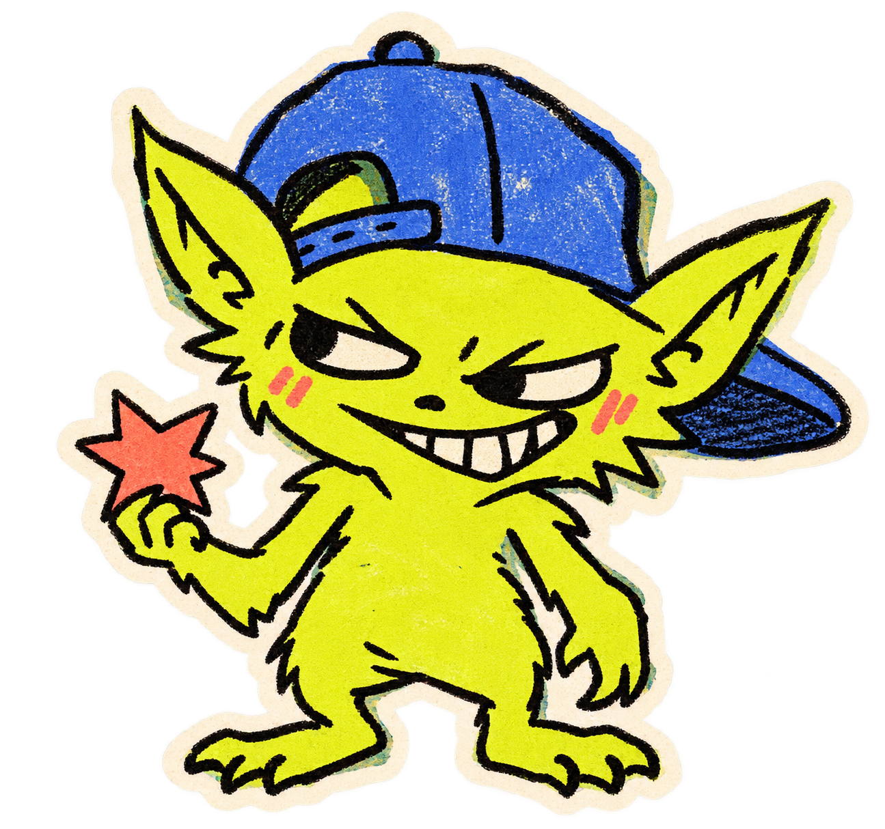
  </picture>
</p>

<p align="center">
  <a href="LICENSE"></a>
  <a href="https://near.org"></a>
  <a href="https://github.com/therascalsdotfun/therascals/actions"></a>
  <a href="https://therascals.fun"></a>
  <a href="https://x.com/therascalsfun"></a>
  <a href="https://github.com/therascalsdotfun/therascals/stargazers"></a>
</p>

<p align="center"><b>Turn the crank. Filter your chaos. Prove your draw. Built on NEAR.</b></p>

<p align="center">
  <a href="https://therascals.fun">Live Arcade</a> |
  <a href="https://therascals.fun/#dao">Contributor DAO</a> |
  <a href="https://perps.near.com/">40x Perps</a> |
  <a href="docs/community-presets.md">Community Presets</a> |
  <a href="docs/agents.md">MCP Agent Guide</a> |
  <a href="https://x.com/therascalsfun">X (@therascalsfun)</a>
</p>

<p align="center">
  <video src="./docs/media/near-first-draw-v2.mp4" poster="./docs/media/poster.jpg" controls width="100%"></video>
  <br>
  <em>Your first draw: connect a NEAR wallet, set the pool, turn the crank, then review the route on <a href="https://therascals.fun">therascals.fun</a></em>
</p>

---

## ⚡ Overview

**TheRascals** is an on-chain token discovery arcade and decentralized contributor governance platform. Instead of doom-scrolling charts and chasing Telegram noise, you define your own token universe — filtering by age, liquidity, market cap, volume, holders, and contract risk — and let arcade mechanics make discovery exhilarating again.

Draw tokens through a real physical **3D Lottery Cage**, an animated **Case Opening**, or a three-reel **Full Degen** randomizer. The winning token is cryptographically committed by the server before the reveal, ensuring verifiable fairness with physical physics matching the outcome. Review real-time DEX charts, exact-asset routes, and risk checks before executing. Every transaction requires your explicit wallet approval — **no automatic trades, no hidden signers, no unauthorized funds spent**.

Beyond discovery, Rascals operates a **Contributor DAO on NEAR testnet**, where developers and community members submit pull requests, an automated review worker scores the work, and the on-chain contract distributes bounties under transparent budget and challenge rules.

> **You only need to**: Define your token universe or paste a community Degen Code, pick your draw mode, and pull the crank.<br/>
> **TheRascals returns**: A verifiably fair token draw, live market charts, an exact swap route, and full control over your wallet execution.

### Our Vision

The arcade merges high-energy meme culture with uncompromised cryptographic honesty:

- **At the Macro Level**: An open, verifiable discovery and governance layer. Transparent server-committed lottery seeds, verifiable fair draws, and a decentralized Contributor DAO on NEAR where builders get on-chain credit and bounties for merged contributions.
- **At the Micro Level**: A playful, tactile sandbox for degens. Physical crank physics in Three.js, bottom-gate ball chutes, CS:GO-style case reels, portable shareable Degen Codes, and wallet-owned preset publishing with multi-venue trade attribution.

---

## 🎨 Brand Universe & Visual Identity

The visual language of TheRascals pairs warm paper textures, hand-drawn mascot art, and physical arcade elements with high-precision 3D mechanics:

<div align="center">
<table>
  <tr>
    <td width="50%" align="center">
      
      <br><b>The Degen Arcade Workshop</b>
    </td>
    <td width="50%" align="center">
      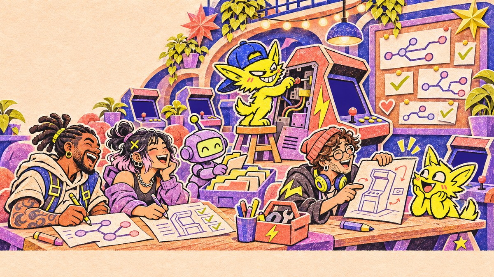
      <br><b>NEAR Contributor DAO Governance</b>
    </td>
  </tr>
  <tr>
    <td width="50%" align="center">
      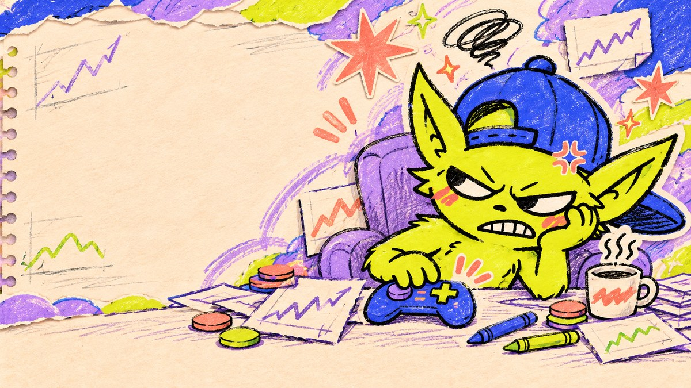
      <br><b>Degen Trenches Token Discovery</b>
    </td>
    <td width="50%" align="center">
      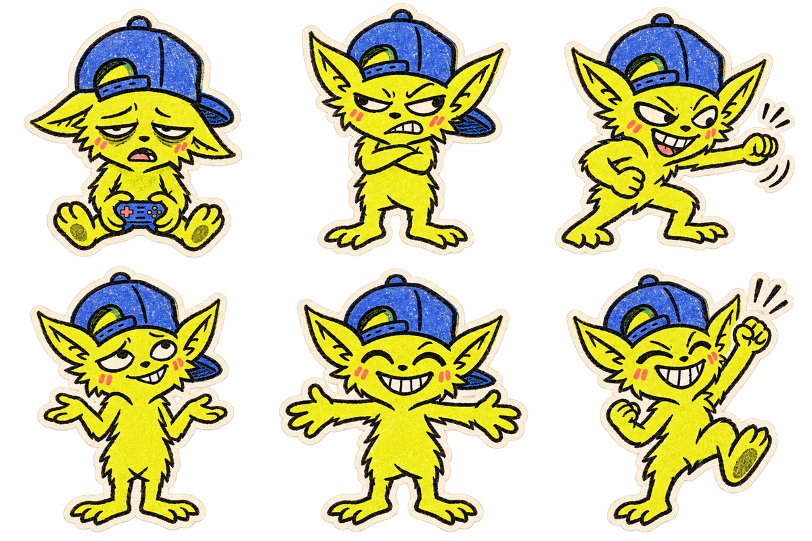
      <br><b>Rascal Mascot Character Figures</b>
    </td>
  </tr>
</table>
</div>

---

## 📸 Product UI Experience

Authentic, high-resolution component captures from the live web application at [therascals.fun](https://therascals.fun):

<div align="center">
<table>
<tr>
<td width="50%">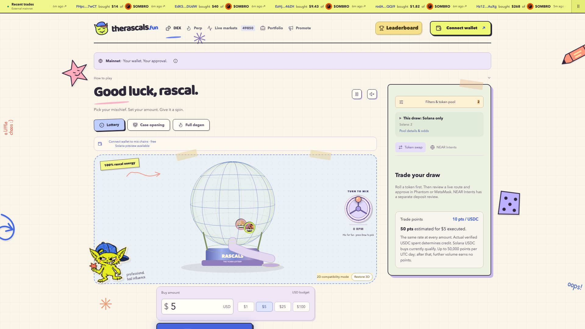<br/><b>3D Lottery Cage</b> - Physical crank & bottom chute extraction</td>
<td width="50%">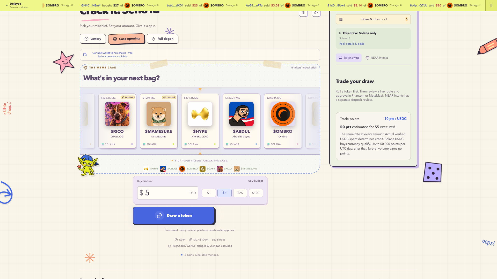<br/><b>Case Opening</b> - Tension reel token unboxing</td>
</tr>
<tr>
<td width="50%">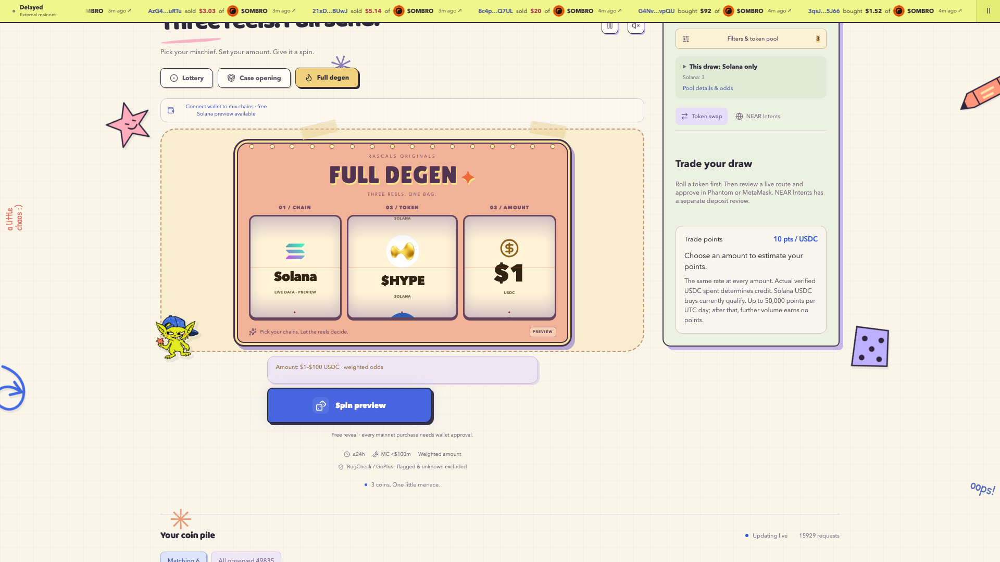<br/><b>Full Degen</b> - Chain, Token & Amount 3-reel spin</td>
<td width="50%">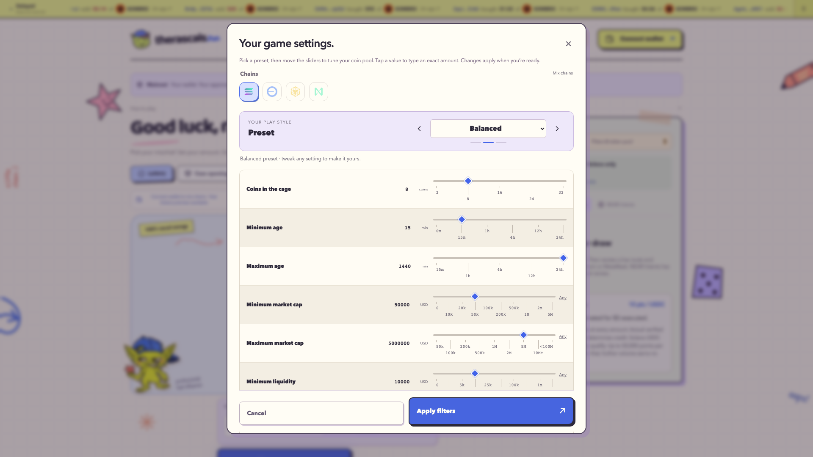<br/><b>Filters & Presets</b> - Custom screening, Degen Codes & usage metrics</td>
</tr>
<tr>
<td width="50%">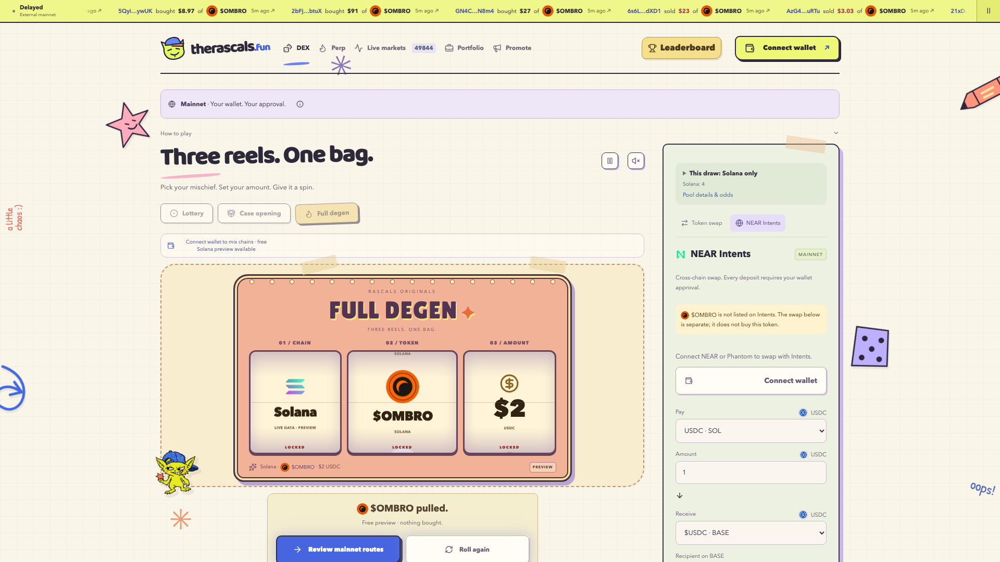<br/><b>NEAR Intents</b> - Cross-chain 1Click quotes & guaranteed receive</td>
<td width="50%">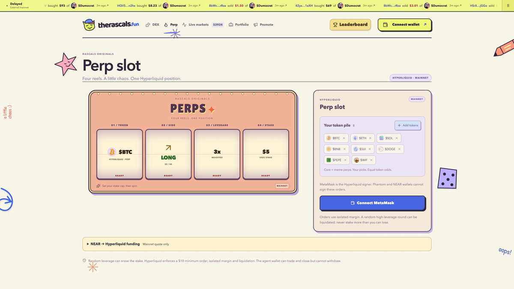<br/><b>Confidential Perps Hub</b> - 40x perpetuals via near.com & Hyperliquid</td>
</tr>
<tr>
<td colspan="2" align="center">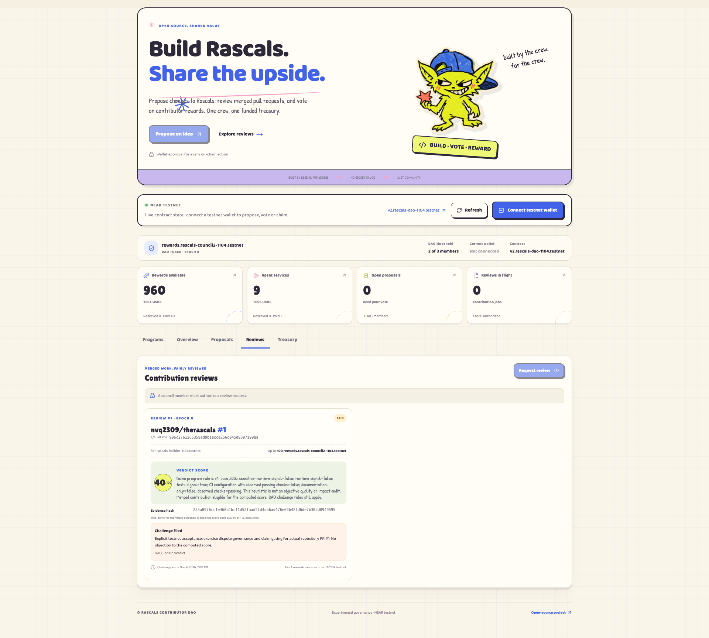<br/><b>Contributor DAO</b> - NEAR testnet governance, review worker scoring & bounty claims</td>
</tr>
</table>
</div>

---

## 🕹️ Arcade & Discovery Modes

| Mode | Mechanic | Experience |
| --- | --- | --- |
| **3D Lottery Cage** | Three.js + cannon-es WebGL physics with bottom extraction chute | Grab and spin the interactive side crank. Speed drives ball agitation; balls settle and exit through the physical bottom chute. The cage physics match a server-committed winner seed. |
| **Case Opening** | Horizontal high-speed tension reel | CS:GO-inspired case unboxing. Screened tokens fly past on a decelerating reel, coming to a halt on the chosen token. |
| **Full Degen** | Triple-reel randomized spin | Spins three independent reels simultaneously: **Chain** (Solana, Base, BNB), **Token** (screened mints), and **Buy Amount** ($1–$100). |
| **Degen Codes & Presets** | Portable filter sharing & wallet-signed publishing | Encode complete filter setups into `DEGEN1...` shareable strings. Publish setups under verified wallet signatures, track community usage, and browse presets by popularity and trade volume. |

---

## 🔄 Workflow

```
┌─────────────────┐     ┌──────────────────────┐     ┌─────────────────┐
│ 1. Filter Pool  │ ──> │ 2. Committed Draw    │ ──> │ 3. Reveal Token │
│ Screening rules │     │ Server commits seed  │     │ 3D Cage / Case  │
└─────────────────┘     └──────────────────────┘     └─────────────────┘
                                                              │
┌─────────────────┐     ┌──────────────────────┐              │
│ 5. Contributor  │ <── │ 4. Wallet Approval   │ <────────────┘
│    DAO (NEAR)   │     │ Exact route & chart  │
└─────────────────┘     └──────────────────────┘
```

1. **Universe Screening**: Define liquidity, market cap, token age, 5m buy/sell transaction count, and social link requirements. Tokens are filtered in real-time from DEX indexes.
2. **Committed Draw**: The server generates a random roll seed and publishes its cryptographic commitment before any physics begin.
3. **Interactive Reveal**: The 3D lottery cage, case opening, or Full Degen reels reveal the selected token. A free reveal places zero trades and spends zero funds.
4. **Route Review & Wallet Approval**: Inspect live DEX candlestick charts, liquidity depth, contract risk analysis, and exact-asset route quotes. Approve the swap in your own wallet (Phantom, MetaMask, or NEAR Connect).
5. **Governance & Payouts**: Builders submit improvements to the repository. The Contributor DAO on NEAR testnet scores merged pull requests and distributes bounties via on-chain smart contract.

---

## 🏛️ NEAR Integrations & Hackathon Highlights

Built for the **NEAR Hackathon**, bridging fast meme discovery with NEAR's infrastructure:

### 1. NEAR Intents (1Click Cross-Chain Swaps)
- Integrated via `@defuse-protocol/one-click-sdk-typescript`.
- Enables cross-chain swap quotes (e.g. NEAR to Solana USDC, Base, or BNB tokens) with guaranteed minimum receive amounts, transparent app fees, and expiration deadlines.
- Users fund swaps by signing a native transfer directly to the deposit address — no automated balance spending or custodial intermediary.

### 2. Contributor DAO on NEAR Testnet (`v2.rascals-dao-1104.testnet`)
- Custom Rust smart contract deployed on NEAR testnet.
- **Council Governance**: Council members vote to approve programs and authorize bounties for merged pull requests.
- **Deterministic Review Worker**: An automated review worker parses GitHub merge evidence, hashes proof digests, scores contributions against rubrics, and submits on-chain verdicts.
- **Challenge Period & Treasury Protection**: Payouts remain locked during a challenge window to prevent malicious claims, before releasing funds to the contributor.
- **Testnet Acceptance Proof**: Verified on-chain testnet acceptance paid 40 test tokens to contributor accounts with zero pending reservations.

### 3. Confidential 40x Perps Hub (`perps.near.com` x Hyperliquid)
- Directly integrated into Rascals' navigation at `/#perps`.
- Exposes 50+ perpetual markets with up to 40x leverage, cross-chain deposit routing via NEAR Intents, non-custodial passkey signing, and margin calculation.
- Direct `⚡ 40x Perps` reveal handoffs in `AdvancedTrading` link revealed tokens to confidential trading on `https://perps.near.com/`.

### 4. Hackathon Track Alignment & Disclosures
- **Tracks**: *Unstoppable DeFi*, *Agent Economy*, *Memecoins With Mechanics*, *Social Money*, and *Open Innovation*.
- **Honest Status Disclosures**:
  - Main arcade discovery, 3D lottery, and swap preflights run live with explicit wallet authorization.
  - The Contributor DAO is an active prototype on NEAR testnet; its test tokens have zero monetary value.
  - Creator fee rebates, NEAR AI cloud inference credit funding, and OutLayer private TEE swaps are documented roadmap items, not active financial products.

---

## 🤖 AI Agent & MCP Server

TheRascals includes an integrated **read-only Model Context Protocol (MCP) server** over local stdio, built with the official TypeScript MCP SDK. It allows autonomous agents (such as Claude, ChatGPT, or NEAR AI) to inspect pools, verify risks, and discover community presets without trade execution risk:

| Tool | Purpose |
| --- | --- |
| `search_presets` | Search community filter presets by popularity, trade volume, or keyword |
| `get_preset` | Fetch exact filter criteria and creator attribution for a specific preset UUID |
| `get_platform_status` | Query active deployment modes, network readiness, and venue support |
| `list_tokens` | Retrieve paginated live token observations with risk and screening reasons |
| `review_pool` | Evaluate pool health, two-way route freshness, and settings-hash conformance |
| `get_token_risk` | Inspect contract risk reports, honeypot checks, and drawdown status |
| `get_token_details` | Inspect indexed DEX metadata for an exact token mint |
| `list_intents_assets` | Query supported NEAR Intents assets and bridge destinations |
| `quote_intents` | Fetch dry, signed mainnet pricing from NEAR to catalog assets (0.1–100 NEAR) |
| `quote_perps_funding` | Dry quote for NEAR-to-HyperCore perps collateral conversion |

See [docs/agents.md](docs/agents.md) for configuration examples and security boundaries.

---

## 🚀 Quick Start

### Prerequisites

| Tool | Required Version | Purpose | Check Command |
| --- | --- | --- | --- |
| **Node.js** | 24+ | Application & server runtime | `node -v` |
| **pnpm** | 10.33+ | Fast monorepo package manager | `pnpm -v` |
| **Rust** | 1.85+ | Smart contracts & review workers | `rustc --version` |

### 1. Clone & Configure

```bash
git clone https://github.com/therascalsdotfun/therascals.git
cd therascals

# Copy example environment configuration
cp .env.example .env
```

### 2. Install Dependencies

```bash
pnpm install --frozen-lockfile
```

### 3. Run Development Services

Start the Fastify API backend and Vite client:

```bash
# Terminal 1: Start API server (port 4317)
pnpm dev

# Terminal 2: Start Vite web frontend (port 5177)
pnpm dev:web
```

Open [http://127.0.0.1:5177](http://127.0.0.1:5177) in your browser.

### 4. Run the Contributor DAO (NEAR Testnet)

```bash
# Build and serve the standalone testnet DAO interface
pnpm dao:release
pnpm dao:serve
```

Open [http://127.0.0.1:4321/dao/](http://127.0.0.1:4321/dao/) to inspect active testnet review programs, council votes, and contributor claims.

### 5. Run Verification & Tests

```bash
# Run application unit and integration test suite
pnpm test

# Verify production builds and release UI boundary checks
pnpm build
pnpm dao:release

# Run Rust smart contract and worker test suites
cargo test --workspace --locked
```

---

## 🧭 Repository Architecture

```
therascals/
├── apps/
│   ├── web/                    # React 19 + Three.js + cannon-es arcade frontend
│   ├── server/                 # Fastify backend, SQLite state, market discovery, presets API
│   ├── dao/                    # NEAR testnet Contributor DAO frontend & release server
│   └── agent/                  # Read-only Model Context Protocol (MCP) server for AI agents
├── packages/
│   └── shared/                 # Shared protocol types, filter schemas, and math helpers
├── contracts/
│   ├── contributor-dao/        # Rust NEAR smart contract for council voting & bounty claims
│   ├── jackpot-session/        # Rust NEAR smart contract for draw session commitments
│   └── demo-usdc/              # Testnet utility token implementations
├── workers/
│   └── contributor-verdict/    # Deterministic review worker scoring PR evidence
├── deploy/                     # Dockerfiles, Caddy configs, and host deployment automation
├── docs/                       # Architecture decisions, contract ABIs, media & documentation
└── tests/                      # 289+ unit, integration, and UI regression test suites
```

---

## 🛡️ Trust Boundaries & Disclosures

- **Non-Custodial**: The application holds zero user funds and never prompts for private keys or seed phrases. All swaps require explicit approval in your connected wallet.
- **Fair Randomness**: Lottery winners are determined by server-side commitments made before the visual reveal. The client cannot manipulate draw outcomes.
- **Honest Economics**: Protocol fees (0.5% entry policy) have been verified in isolated testing and are currently disabled on mainnet. Free reveals cost zero dollars and place no on-chain trades.
- **Testnet Governance**: Contributor DAO contracts operate on NEAR testnet (`*.testnet`). Distributed tokens represent governance test credits with zero monetary value.

---

## 📄 License & Attribution

Distributed under the **MIT License**. See [LICENSE](LICENSE) for details.

Assisted-by: [Cindy](https://cindy.app)
